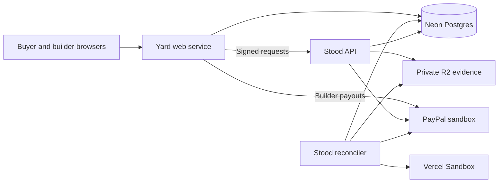

# Render: deploy Stood and Yard, step by step

This guide describes Stood's actual hosted PayPal **sandbox**, checked on 13 October 2026. Render hosts two HTTP services and one background worker from the same repository. Neon holds the durable records; Cloudflare R2 holds evidence; Vercel Sandbox runs untrusted builder code. No real money moves in this deployment.

Start with the repository's [Blueprint](../../render.yaml), [setup record](../SETUP.md), [Dockerfile](../../Dockerfile) and [Yard Dockerfile](../../services/yard-api/Dockerfile). The Blueprint is the source of service configuration; this guide explains why each service exists and how to check a release.

## 1. What Render runs

| Service | Type | Responsibility | Entry point |
| --- | --- | --- | --- |
| `stood-api` | Web, Starter, Frankfurt | Signed allowance, signing, funding, package, usage and upload HTTP endpoints; PayPal webhook intake | Image default command |
| `stood-reconciler` | Background worker, Starter, Frankfurt | Durable signing/funding recovery, evidence runner jobs and settlement reconciliation | `/nodejs/bin/node dist/reconcile-cli.js` |
| `stood-yard-api` | Web, Starter, Frankfurt | Hosted Yard app, owner-issued sessions, Board, Foreman and Stood payment projections; payout and cleanup jobs | Yard image default command |



Render hosts the application processes. The background worker must remain running for queued work to advance; an HTTP response accepting a request does not mean its provider operation finished. Kernel drives a sandbox buyer's approval browser during qualification commands, outside these hosted services. GitHub Pages publishes the public landing page and generated API portal separately.

## 2. Prerequisites

Use a Render workspace with billing enabled for the paid services, connected to the GitHub repository. Set up the Neon database and Yard's restricted database role using [SETUP](../SETUP.md#4-neon-postgres). Keep the database near the services; this deployment uses Frankfurt.

Prepare the private settings before deployment. The Blueprint marks prompted values with `sync: false`; no credential values belong in Git, screenshots or tickets. Render documents the field behavior in its [Blueprint reference](https://render.com/docs/blueprint-spec).

| Settings | Services | Why they must agree |
| --- | --- | --- |
| `DATABASE_URL` | Stood API and reconciler | Both read the same durable Stood records |
| `STOOD_API_KEY`, `STOOD_HMAC_SECRET` | Stood API and Yard | Yard authenticates and signs requests to Stood |
| `VAULT_TOKEN_KEYS` | Stood API and reconciler | Saved PayPal tokens must be readable across the signing/funding lifecycle |
| `PAYPAL_CLIENT_ID`, `PAYPAL_CLIENT_SECRET` | Stood API and reconciler | Same Stood sandbox REST app |
| `STOOD_EVIDENCE_S3_*` | Stood API and reconciler | Upload intake and runner evidence use the qualified private bucket |
| `USAGE_AUTHORITY_KEYS` | Stood API | Trusts the public half of Yard's usage signing key |
| `YARD_USAGE_KEY_ID`, `YARD_USAGE_SIGNING_KEY` | Yard | Signs the buyer's independent final-milestone usage receipt |

Yard uses `YARD_DATABASE_URL` for its restricted runtime role and `YARD_MIGRATION_DATABASE_URL` for schema changes. Its own `YARD_PAYPAL_CLIENT_ID` and `YARD_PAYPAL_CLIENT_SECRET` are a **separate** sandbox app for builder payouts. Do not substitute Stood's credentials. The remaining planner, GitHub App, runner and operator settings are listed in the Blueprint and [service environment table](../SETUP.md#variables-on-each-render-service).

In this codebase, `PROVIDER_PAYPAL=live` selects the real provider adapter, while `PAYPAL_BASE_URL=https://api-m.sandbox.paypal.com` confines it to the sandbox. The word `live` here does not mean real-money PayPal. Keep the sandbox host.

## 3. Create the Blueprint

1. Ensure the reviewed `render.yaml` is on `main`.
2. In Render, choose **New → Blueprint**, connect `ma-za-kpe/stood`, and select `main`.
3. Review all three services, their Dockerfiles, Frankfurt region and Starter plans before applying.
4. Supply the prompted private settings through Render's environment controls. Keep operator access codes private.
5. Check the migration commands before starting the first release.

All three services specify `autoDeployTrigger: checksPass`: a main commit's CI checks must complete successfully before automatic deployment. Blueprint synchronization and service auto-deployment are separate controls; inspect both when investigating an unexpected deploy. See [Render deployment behavior](https://render.com/docs/deploys) and [Blueprint synchronization](https://render.com/docs/infrastructure-as-code).

The root build context is intentional: both Dockerfiles build a workspace with shared packages. Do not change it to an individual service directory without adjusting the workspace build.

## 4. Migrate before serving new code

The reconciler's pre-deploy command is:

```text
/nodejs/bin/node dist/migrate-cli.js
```

Yard's pre-deploy command is:

```text
/nodejs/bin/node dist/db-cli.js migrate
```

A failed pre-deploy command blocks that service's new deploy. Render executes it separately from the running service, so filesystem changes there are not a way to modify the deployed image. This behavior is documented under [pre-deploy commands](https://render.com/docs/deploys#pre-deploy-command).

Stood API has **no** pre-deploy migration command in the current Blueprint. For a first install or a schema-dependent release, deploy the reconciler and verify its migrations before deploying the API. Three services becoming live independently is not a transaction across the application. Automatic deploys can overlap, so migrations must remain compatible with both the previous and new code while services transition.

Yard performs its own migrations with the owner role, then serves requests using the restricted runtime role. A successful image build is not migration evidence. Record the deploy's pre-deploy result and the database migration journal when qualifying a release.

## 5. Check the running services

Public checks:

```console
curl --fail --silent --show-error https://stood-api.onrender.com/health
curl --fail --silent --show-error https://stood-yard-api.onrender.com/health
curl --fail --silent --show-error https://stood-api.onrender.com/v1/openapi.json
```

Stood's health response reports configuration readiness for sandbox payments and lists missing settings. Yard reports capabilities such as Board, intake, Foreman and payments. Neither endpoint proves that every database query, worker loop or external provider is healthy. The worker has no public HTTP health endpoint.

Check Render's deploy state and commit separately for **each** service, then read its startup and job logs. Check runner progress and sanitized WAIT reasons, funding transitions and settlement counts. A configuration-ready API with a stopped reconciler can accept work that never advances.

On 12 October, all three services were independently confirmed live on `fdfa92abf9b87dcb8a31047fba4387cf81915592`. Both public health responses were successful. This is a dated deployment observation, not a promise that a later release or external dependency is healthy.

## 6. Qualify the actual payment path

Once migration, deployment and health checks pass, run the existing hosted qualification command with the owner's sandbox-only settings:

```console
scripts/dev yard-live-e2e
```

It uses hosted buyer/builder sessions, creates a frozen-test baseline and work order, obtains genuine PayPal approval through Kernel, submits through Yard, waits for the Vercel judge and supplies the buyer's usage receipt. It qualifies PAID only when Yard's exact package, tranche, amount and capture reference agree with Stood's provider-backed settlement.

Private recordings live under `.sandbox/yard-live/`. If interrupted, inspect that recording and reconcile the existing provider facts before resuming the **same** project:

```text
scripts/dev yard-live-e2e --resume <recorded project id>
```

Never start a replacement payment merely because a response was lost. Independently read the capture and parent order from PayPal to confirm amount, completion and capture count. This test qualifies the hosted session HTTP path; it does not prove UI clicks or builder payout completion. See the [recorded hosted run](../../services/api/test/scenarios/sandbox/yard-hosted-2026-10-12.json) and [PayPal guide](paypal-sandbox-authorize-capture-void.md).

## 7. Problems we actually encountered

| Symptom | Cause and action |
| --- | --- |
| Blueprint rejects the worker with `need_payment_info` | This setup requires paid instances; add the workspace payment method before applying |
| Signed requests fail after a very slow wake-up | The API previously slept on the free plan; the signature expired during startup. Starter keeps the API running |
| Reconciler exits instead of starting | Docker command must explicitly invoke the Node binary in this distroless image; use the command in the Blueprint |
| API accepts work but nothing advances | Inspect reconciler deployment, configuration and job logs; `/health` is not its heartbeat |
| `Settlement off` | `SETTLEMENT_EXECUTOR` is not `on`; enable only after the required sandbox qualification/release review |
| `Packages off` | Yard lacks its Stood package gateway settings; verify the shared signed credentials and Stood URL |
| `Previews off` | Optional preview workspace credentials are absent; use a separate preview workspace if enabling them |
| Upload URLs unavailable although runner evidence works | The API also needs the private bucket settings; configuring only the reconciler is insufficient |
| Token cannot be opened | API and worker key rings differ or a key was removed too soon; follow the documented key rotation process |
| Environment edit appears ineffective | Check the subsequent deploy and the configuration actually used by that instance |

Startup notes are capability-specific. An expected `Previews off` does not disable settlement, and a missing capability should not be relabeled as healthy simply because the process responds.

## 8. Rollback and recovery

Before a rollback, record the current commit, failing stage and pending provider operations. A prior image does not undo database migrations or PayPal effects. Choose an image compatible with the current schema and key ring. Never delete financial rows or issue another capture to repair a deployment.

Render can reuse an available previous build artifact. A dashboard rollback disables auto-deploys; an API rollback does not. After diagnosing and fixing the cause, deliberately restore the intended auto-deploy behavior and verify each service. These distinctions and artifact-retention limits are in [Render's rollback documentation](https://render.com/docs/rollbacks).

Use `scripts/dev funding-recover` only with the matching PayPal order id; it reads provider facts. The guarded no-order close-out additionally needs the recorded provider rejection, named operator/reason and age checks. Missing local data alone is insufficient.

## 9. Cost and evidence to share

This deployment uses three Starter instances; the worker and the always-on APIs have ongoing compute costs. Neon, R2, Vercel Sandbox and Kernel are separate services with their own usage. Check current Render billing and the [pricing page](https://render.com/pricing) before choosing a plan; this guide does not freeze a price or claim the entire system is free.

For a release record, capture the three service names, commit and deploy states; migration success; sanitized health responses; and the independent sandbox payment outcome. Mask credentials, operator codes, payer details and environment values in dashboard screenshots. Keep private operational recordings outside Git. A screenshot of a green deploy is useful deployment evidence, but the payment claim still requires matching provider facts.
